  

  
  
  

## 🚀 Về mình

  

## 🌟 Dự án nổi bật

<table>
  <tr>
    <td width="50%" valign="top">
      <h3>📊 <a href="https://github.com/vongocluy123456789012345-design/Quanlyggsheet">Quanlyggsheet</a></h3>
      
<b>AI Workspace Manager</b> — một web app quản lý tất cả Google Sheets, Drive, Gmail, YouTube và Google Maps, có trợ lý Gemini tích hợp.

      

        
        
        
      

    </td>
    <td width="50%" valign="top">
      <h3>🧾 Phần mềm kế toán &amp; hoá đơn</h3>
      
Tải và đối chiếu hoá đơn điện tử, dự báo thuế GTGT, báo cáo — chạy ngay trên máy tính, dữ liệu nằm trong tay mình.

      

        
        
        
      

    </td>
  </tr>
</table>

## 🛠️ Công cụ mình dùng

  
  
  
  
  
  
   
  
  
  
  
  
  

## 📈 Hành trình

| Giai đoạn | Mục tiêu |
|---|---|
| ✅ Đã xong | Web app quản lý Google Workspace + Gemini, giao diện sáng/tối |
| ✅ Đã xong | Tích hợp YouTube, Google Maps, đọc hoá đơn PDF bằng AI |
| 🔄 Đang làm | Quản lý nhiều công ty / MST, nhắc hạn tờ khai |
| 🎯 Sắp tới | Tự động đối chiếu sao kê ngân hàng với sổ sách |

  

<i>⭐ Nếu thấy dự án hữu ích, tặng mình một ngôi sao nhé!</i>

